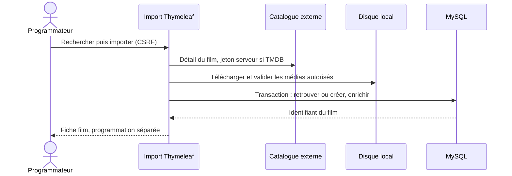

# Architecture

## 1. Vue d'ensemble

Application unique Spring Boot, un seul module Maven, organisée **par fonctionnalité métier**
plutôt que par couche technique globale. Chaque paquet contient son entité, son repository, son
service, son contrôleur et ses DTO : une évolution du modèle reste localisée.

```text
fr.butinfo.cinema
├── CinemaApplication          point d'entrée Spring Boot
├── config
│   ├── SecurityConfig         2 chaînes de filtres (API stateless, UI avec session)
│   └── OpenApiConfig          métadonnées OpenAPI + schéma d'authentification Basic
├── common.error               erreurs transverses
│   ├── ApiError / ChampErreur corps d'erreur JSON stable
│   ├── MetierException        racine abstraite des exceptions métier
│   ├── DonneeInvalideException        → 400
│   ├── RessourceIntrouvableException  → 404
│   ├── ConflitMetierException         → 409
│   ├── CapaciteInsuffisanteException  → 409 (message contextualisé)
│   └── GlobalExceptionHandler @RestControllerAdvice des contrôleurs REST
├── film
│   ├── Film, FilmRepository, FilmService, CreerFilmCommand
│   └── api/ FilmController (lecture), ProgrammationFilmController (création)
├── salle
│   ├── Salle, SalleRepository, SalleService, CreerSalleCommand
│   └── api/ SalleController (lecture), SalleAdminController (création)
├── seance
│   ├── Seance, SeanceRepository, SeanceService, CreerSeanceCommand, SeanceResult
│   └── api/ SeanceController (lecture), ProgrammationSeanceController (création)
├── reservation
│   ├── Reservation, StatutReservation, ReservationRepository
│   ├── ReservationService, ReservationMetrics, CreerReservationCommand, ReservationResult
│   └── api/ ReservationController
├── security                  401/403 en JSON
│   ├── JsonAuthenticationEntryPoint
│   └── JsonAccessDeniedHandler
└── ui                        frontend Thymeleaf (extension hors barème)
    ├── HomeController, CatalogueController, ReservationUiController
    ├── AdminUiController, LoginController
    ├── GlobalModelAttributes  currentUser, estAdmin, estProgrammateur, estClient
    ├── FormattingHelper       formats fr-FR (dates, monnaie) exposé comme bean `@format`
    ├── UiExceptionHandler     pages d'erreur HTML
    └── form/                  objets de formulaire avec validation Jakarta
```

## 2. Règles de dépendance

```text
api (contrôleurs)  →  service  →  repository  →  base MySQL
        ↓                ↓
      dto            entités / résultats
```

- Un contrôleur ne contient **aucune règle métier** : il valide la forme (`@Valid`), convertit en
  commande, délègue, met en forme la réponse HTTP (statut, `Location`).
- Un service porte les règles et délimite les transactions (`@Transactional`).
- Un repository ne contient que des requêtes.
- Les entités ne sortent jamais d'un service : la conversion vers un `record` de résultat se fait
  dans le service (`SeanceResult`, `ReservationResult`) ou le DTO (`FilmResponse.depuis`).
- Le paquet `ui` dépend des services, jamais des repositories.
- `common.error` est une dépendance descendante : tout le monde peut lever une exception métier,
  seul `GlobalExceptionHandler` connaît HTTP pour l'API et `UiExceptionHandler` pour le HTML.

## 3. Flux applicatifs

### 3.1 Lecture publique

```text
GET /api/seances?du=&au=
  SeanceController#lister
    SeanceService#rechercher            @Transactional(readOnly = true)
      SeanceRepository#rechercher       jointure film + salle (EntityGraph)
      ReservationRepository#sumPlacesParSeance   une requête agrégée pour toutes les séances
    calcul placesRestantes = capacite - placesConfirmees
  List<SeanceResponse>
```

Aucune entité n'est sérialisée : les `SeanceResponse` ne contiennent que des champs utiles, sans
données techniques (`@Version`, relations paresseuses, etc.).

### 3.2 Création d'une réservation

```text
POST /api/reservations
  ReservationRequest (@Valid : seanceId, emailClient, nombrePlaces ∈ [1 ; 8])
  ReservationController#creer
    ReservationService#creer        @Transactional
      1. validation défensive (service réutilisable hors MVC)
      2. SeanceRepository#findByIdForUpdate   ← SELECT ... FOR UPDATE
      3. ReservationRepository#sumPlacesBySeanceIdAndStatut(CONFIRMEE)
      4. si placesRestantes < demandées  → CapaciteInsuffisanteException → 409
      5. montant = prixUnitaire × places (HALF_UP, 2 décimales, côté serveur)
      6. code unique RES-XXXXXXXXXX (vérification + contrainte UNIQUE en base)
      7. saveAndFlush → contrainte d'unicité et de places vérifiée par MySQL
      8. métriques Micrometer
  ReservationResponse (201)
```

### 3.3 Annulation

```text
DELETE /api/reservations/{code}
  ReservationService#annuler         @Transactional
    1. findByCode → 404 si absent
    2. findByIdForUpdate(seance)      même verrou que la création
    3. si CONFIRMEE : statut = ANNULEE (les places sont libérées par la somme filtrée)
    4. métrique "annulee"
  204
```

L'annulation est idempotente : annuler deux fois une réservation déjà annulée renvoie 204 sans
effet supplémentaire.

## 4. Concurrence : verrou pessimiste

### Pourquoi

Deux instances de l'application ne partagent pas de mémoire : `synchronized` ou un `Lock` Java
sont inopérants (et explicitement refusés par le sujet). Le seul point de sérialisation commun est
la base. Le verrou pessimiste sur la ligne `seances` sérialise les opérations d'une même séance,
sans bloquer les autres séances.

### Séquence du scénario obligatoire

Capacité 20, déjà 15 places confirmées, deux requêtes simultanées de 4 places :

```text
Thread A                         Thread B                         Base
-------------------------------------------------------------------------------
BEGIN
SELECT ... FOR UPDATE  ───────────────────────────────────────►  verrou ligne seance 1
                                 BEGIN
                                 SELECT ... FOR UPDATE  ───────►  BLOQUE (attente du verrou)
SUM(places)=15
15 + 4 = 19 ≤ 20  → OK
INSERT réservation (4)
COMMIT  ───────────────────────────────────────────────────────►  verrou libéré
                                 (verrou obtenu)
                                 SUM(places)=19
                                 19 + 4 = 23 > 20  → refus
                                 ROLLBACK
                                 ──────────────────────────────►  409 CAPACITE_INSUFFISANTE
```

Résultat : `201` et `409`, aucune écriture partielle, total confirmé `19 ≤ 20`.

### Alternatives écartées

| Alternative | Raison de l'écart |
|---|---|
| `synchronized` / `ReentrantLock` | Ne protège qu'une JVM ; refusé par le sujet |
| Verrou optimiste `@Version` | Nécessite une boucle de reprise côté appelant ; le conflit devient un 409 après réessai, sémantique moins directe ici |
| Contrainte SQL calculée (`CHECK` sur un agrégat) | MySQL ne permet pas de contraindre un agrégat d'une autre table |
| Niveau d'isolation `SERIALIZABLE` | Coût global sur toutes les requêtes ; portée moins fine que le verrou de ligne |

## 5. Sécurité

Deux chaînes de filtres ordonnées, car l'API est stateless et l'interface Thymeleaf a besoin de
session, de formulaire de connexion et de CSRF.

```text
@Order(1) securityMatcher("/api/**", "/v3/api-docs/**", "/swagger-ui/**", "/swagger-ui.html", "/actuator/**")
  csrf désactivé            API consommée par des clients non navigateur
  session STATELESS
  httpBasic
  401/403 → JSON (JsonAuthenticationEntryPoint / JsonAccessDeniedHandler)

@Order(2) tout le reste
  formLogin /login          CSRF actif
  session
  403 → page /acces-refuse
```

Les comptes de démonstration sont déclarés en mémoire (`InMemoryUserDetailsManager`) avec des
hachages BCrypt. Aucun mot de passe en clair n'existe dans les sources ; les mots de passe
documentés dans le README sont ceux de la démonstration, pas des secrets de production.

## 6. Persistance

- Schéma **exclusivement** créé par Flyway (`V1__schema_initial.sql`, `V2__donnees_demonstration.sql`).
- `spring.jpa.hibernate.ddl-auto=validate` : Hibernate vérifie la correspondance, ne crée rien.
- `open-in-view=false` : aucune session JPA ouverte pendant le rendu des vues.
- Types : `DECIMAL(10,2)` pour les prix et montants, `DATETIME(6)` pour les horodatages,
  `VARCHAR` pour les codes et noms.
- Contraintes portées par la base : unicité (`uk_salles_nom`, `uk_reservations_code`), plages
  (`ck_films_duree`, `ck_salles_capacite`, `ck_reservations_places`), énumérations
  (`ck_reservations_statut`), clés étrangères.
- Index : `films(titre)`, `films(genre)`, `seances(debut)`, `seances(film_id)`,
  `seances(salle_id)`, `reservations(seance_id, statut)`, `reservations(email_client)`.

### Fuseau horaire

Le pilote est configuré avec `connectionTimeZone=LOCAL` et
`hibernate.type.java_time_use_direct_jdbc=true`. Sans cela, `LocalDateTime` subissait un décalage
de conversion UTC (20:00 stocké, 21:00 relu en heure d'été française). Le comportement est
vérifié de bout en bout : 20:00 en base → `2026-11-05T20:00:00` dans l'API et dans l'interface.

## 7. Interface Thymeleaf

Extension hors barème, techniquement isolée :

- Mêmes services que l'API : aucune duplication de règle métier.
- Objets de formulaire dédiés (`ui/form`) : la validation Jakarta s'applique aussi côté serveur.
- CSRF actif sur tous les formulaires (`th:replace="~{fragments/layout :: csrf}"`).
- `GlobalModelAttributes` expose `currentUser`, `estAdmin`, `estProgrammateur`, `estClient` à toutes
  les vues, ce qui pilote l'affichage du menu et des cartes d'administration.
- `FormattingHelper` (bean `@format`) centralise les formats français : `05/11/2026`, `20:00`, `9,90 €`.
- Aucune ressource externe (pas de CDN, pas de police distante) : chargement instantané et
  fonctionnement hors ligne.

## 8. Tests

```text
src/test/java/fr/butinfo/cinema
├── support/TestEntities            fabrique d'entités et de payloads
├── reservation/ReservationServiceTest        unitaire + métriques (Mockito)
├── reservation/ReservationControllerMvcTest  tranche MVC + sécurité + erreurs
├── security/ApiSecurityMvcTest               matrice 401/403/201
├── reservation/ReservationRepositoryTest     JPA + MySQL Testcontainers
├── CinemaIntegrationTest                     contexte complet + MySQL Testcontainers
└── reservation/ReservationConcurrencyTest    deux threads + MySQL Testcontainers
```

Choix : les tests Testcontainers portent `@Testcontainers(disabledWithoutDocker = true)`, donc un
poste sans Docker voit ces classes ignorées sans faire échouer le build, conformément au sujet.


## Extension de catalogue et interface — 2026-10-21

`CatalogueImportController → CatalogueExterneService / ImportFilmService → FilmService / FilmRepository`.
Les réponses externes sont des `FilmExterne` immuables. `AffichesService` valide et conserve les
médias hors transaction ; `ImportFilmService` applique ensuite l'enrichissement dans une
transaction courte. La contrainte V4 empêche un doublon pour un même identifiant fournisseur.
Les vues publiques affichent uniquement les films enregistrés et leurs médias locaux.



La réservation conserve son verrou pessimiste. L'annulation emploie aussi une mise à jour
conditionnelle du statut pour distinguer une transition réelle d'une demande déjà traitée.
Les compteurs de succès sont publiés après commit, via `TransactionSynchronization`.
